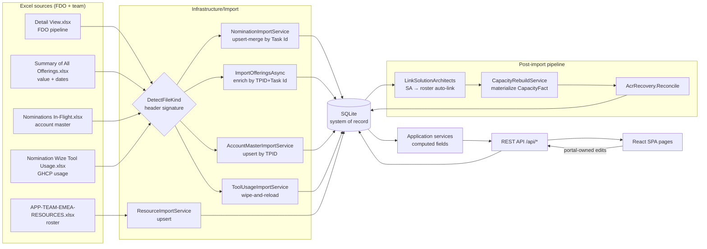

# CAF Operations Portal — System Reference (Data Model · Logic · Pages)

> **Purpose.** A single, reviewable reference of *what data exists, where it comes from, who owns it, how every
> number on every page is computed, and which rules are configurable vs hardcoded*. It is the baseline for the
> "everything logic/config-driven, nothing hardcoded" enhancement track (§10–§11).
>
> **Snapshot date:** 2026-10-13 · **Schema:** EF Core 9 / SQLite (`src/CafPortal.Api/App_Data/cafdb.sqlite`) ·
> **Verified against:** code on `main` + the live database (row counts in §3).

**Legend used throughout**

| Mark | Meaning |
|---|---|
| ⚙️ | Configurable at runtime (ApplicationSetting / LookupValue / master table, editable in the UI) |
| 🗄️ | Stored in the DB but **not editable in the UI** (needs a DB edit or seed change) |
| 🔒 | **Hardcoded** in C# or TypeScript (needs a code change + deploy) |
| ⚠️ | Known inconsistency / duplication / risk — see §10 |

---

## Contents

1. [Architecture & data lifecycle](#1-architecture--data-lifecycle)
2. [Data sources & ingestion rules](#2-data-sources--ingestion-rules)
3. [Database schema](#3-database-schema)
4. [Field ownership matrix (FDO vs Portal vs Derived)](#4-field-ownership-matrix)
5. [Core business logic (computed fields)](#5-core-business-logic)
6. [API catalog](#6-api-catalog)
7. [Pages — data, widgets, computations](#7-pages)
8. [Configuration inventory (what is already editable)](#8-configuration-inventory)
9. [Hardcoded logic inventory](#9-hardcoded-logic-inventory)
10. [Known inconsistencies & duplicated logic](#10-known-inconsistencies--duplicated-logic)
11. [Roadmap: make everything logic/config-driven](#11-roadmap-logic-driven-design)

---

## 1. Architecture & data lifecycle

**Key principles (must be preserved by any change)**

1. **After import, the web app is the system of record.** FDO drops refresh only FDO-owned fields (§4).
2. **Nominations are never hard-deleted by imports.** Rows missing from a drop are soft-set `Withdrawn`. Settled rows and rows that are actively executing are protected, and a row that comes back in a later drop is restored.
3. **Derived data is rebuilt, never edited:** `CapacityFact` is rebuilt on startup and after every import, merge, park, alias or rename.
4. **Portal-owned governance data** (gates, blockers, milestones, classification, short name, ledger) is never touched by imports.
5. **Region scope** is applied server-side (`?region=`). **Fiscal-year scope** is applied client-side (`nominationInFy`).

---

## 2. Data sources & ingestion rules

All uploads go through **`POST /api/admin/upload-auto`** (Nominations page and GHCP Adoption page → **Upload**). The
server reads the first header row and routes by signature in `DataRefreshService.DetectFileKind`
(**order matters**, 🔒):

| # | File | Detection signature (header row) | Importer | Match key | Write mode |
|---|---|---|---|---|---|
| 1 | **Nomination Wize Tool Usage** | `Tool Name` + `Category` + (`Created Date` \| `Offering Name and Phase`) | `ToolUsageImportService` | Task Id → `Nomination.ExternalTaskId` | **Wipe-and-reload** `NominationToolUsageFacts` |
| 2 | **Summary of All Offerings** | `Factory Offering` + (`Total ACR` \| `Offering Id` \| `Is Tool Attached`) | `DataRefreshService.ImportOfferingsAsync` | TPID + Task Id | Enrich matched; **create `Completed`** nomination for unmatched rows with `Actual End Date` |
| 3 | **Detail View** (FDO pipeline) | `1 - Validating & Initial Scope` \| `Nomination Approval Status` \| `Linked to ID` | `NominationImportService` | **Task Id** (fallback account+offering) | **Upsert-merge** + symmetric soft-withdraw/revive |
| 4 | **Nominations In-Flight** (account master) | `Segment` + `TPID` + (`Customer Name` \| `Account ID`) | `AccountMasterImportService` | TPID → Account ID → alias-aware name | **Additive upsert**: never deletes, never touches ownership, region or status |
| – | Resource roster | (separate upload kind `resources`) | `ResourceImportService` | PSID / Email / Name | Upsert, then capacity rebuild |

### 2.1 Detail View → `Nominations` (most important import)

* **Columns read:** TPID, Task Id, Account ID, Customer Name, Offering Name, Nominated date, Migration Status,
  4 stage day-count columns (`1 - Validating…` … `4 - Executing Migration`), Approval Status, Region, Status Summary,
  Next Best Action, Current State, Solution Architect, CFTL, Project Coordinator, `Linked to` / `Linked to ID`.
* **Account resolution:** TPID → ExternalAccountId → name/alias (creates the account by TPID if missing, Segment blank).
* **StageAgeDays:** the day-count of the row's *current* stage column (values like `"9 days"`).
* **Ownership (PM/CFTL/SA):** overwritten from FDO on every drop. **A blank FDO cell keeps the current value.**
* **Status mapping** (`MapStatus(migration, approval)`, 🔒): `Declined` → `Withdrawn`; otherwise derived from the
  migration text. Applied on insert and on revive. Existing portal statuses are preserved.
* **Withdraw guard** (🔒): rows missing from the drop become `Withdrawn` **unless** they are settled
  (`Withdrawn/Closed/Completed/CustomerDeferred`) or **actively executing** (`IsActivelyExecuting` = Approved AND no
  `ActualEndDate` AND migration text contains `executing`/`finalize`).
* **Wave links:** `Linked to` names are split on `;` and classified by keyword (🔒 `security`→Security,
  `sql|ossdb|database`→Db, `landing zone|alz`→LandingZone, `dispatch`→Dispatch; App/unknown skipped). Links with
  `Source="FDO"` are refreshed on every drop; links with `Source="Portal"` are preserved.
* **History:** each run writes an `ImportRun` plus `ImportChange` rows (Added / Updated with field-level from→to / Withdrawn). History rows are pruned after `HistoryRetentionDays` (⚙️ default 90).

### 2.2 Summary of All Offerings → offering enrichment

Sets `PrimaryMigrationPath, PartnerName, TotalCores, IsToolAttached, IsAutomationUsed, ModeOfAccess, TotalAcr,
NnrAcr` and the dates `NominatedDate, ApprovalDate, Actual/Planned Start/End, TotalDays`. A matched row is marked
`Completed` once it has an `ActualEndDate`. It also refreshes `Account.Segment` by TPID. ACR recovery
reconciliation runs afterwards.

### 2.3 Nomination Wize Tool Usage → `NominationToolUsageFacts`

* Reads **sheet 1 only**. The `GHCPUsage` sheet is a pivot summary and is ignored.
* Captures `Account ID, TPID, Task ID, Details, Category, Tool Name, Created Date`. Resolves `NominationId` by Task Id
  (unmatched rows are kept with a null `NominationId`).
* **1-to-many:** a nomination can have several usage rows.
* The raw `Tool Name` is stored as-is. It is **normalized at read time** by `ToolNameNormalizer` (§5.9), and the
  activity is **inferred** by `ToolActivityClassifier` (§5.10).

### 2.4 Post-import pipeline (every refresh/upload)

`LinkSolutionArchitectsAsync(apply)` → `CapacityRebuildService.RebuildAllAsync()` → `AcrRecoveryService.ReconcileAsync()` →
stamp `LastDataRefreshUtc` (shown as "Updated Xm ago" in the header).

---

## 3. Database schema

### 3.1 Entity-relationship overview

```mermaid
erDiagram
  Account ||--o{ Nomination : "AccountId (SetNull)"
  Account ||--o{ ResourceAccount : ""
  Account ||--o{ OwnershipHistory : ""
  Account ||--o{ EngagementFact : ""
  Account ||--o{ StrategicAccountConfiguration : ""
  Resource ||--o{ ResourceAccount : ""
  Resource ||--o{ NominationResource : ""
  Resource ||--o{ CapacityFact : ""
  Resource ||--o{ LeaveFact : ""
  Resource ||--o{ PerformanceReview : "ResourceId (optional)"
  Nomination ||--o{ NominationResource : "team"
  Nomination ||--o{ WaveLink : "waves"
  Nomination ||--o{ NominationGateItem : "gate state"
  Nomination ||--o{ NominationBlocker : ""
  Nomination ||--o{ NominationEvent : "audit"
  Nomination ||--o{ NominationMilestone : ""
  Nomination ||--o{ NominationToolUsage : "manual capture"
  Nomination ||--o{ NominationToolUsageFact : "FDO import"
  Nomination ||--o{ AcrRecoveryEntry : "ledger"
  GateDefinition ||--o{ GateItemDefinition : ""
  GateItemDefinition ||--o{ NominationGateItem : ""
  MigrationTool ||--o{ MigrationToolActivity : "can support"
  MigrationActivity ||--o{ MigrationToolActivity : ""
  MigrationTool ||--o{ NominationToolUsage : ""
  MigrationActivity ||--o{ NominationToolUsage : ""
  ImportRun ||--o{ ImportChange : ""
  RoleConfiguration ||--o{ RolePermission : ""
```

### 3.2 Table inventory (with live row counts)

| Area | Table | Rows | Ownership | Purpose |
|---|---|---:|---|---|
| **Core** | `Nominations` | 1,112 | FDO + Portal (§4) | One migration engagement (FDO "Task") — the central aggregate |
| | `Accounts` | 818 | FDO identity + Portal ownership | Canonical customer master (TPID-keyed) |
| | `AccountAliases` | 39 | Portal | Alias → canonical account name |
| | `Resources` | 81 | Portal (roster upload) | Team members (roster) incl. `Aliases`, `Grade` |
| | `NominationResources` | 374 | Portal + auto (`Source="SA"`) | Team on a nomination; **basis of capacity** |
| | `WaveLinks` | 259 | FDO (`Source=FDO`) + Portal | Related waves (DB/Security/ALZ/Dispatch) |
| | `ResourceAccounts` | 292 | Import (wipe-and-rebuild ⚠️) | Legacy resource↔account mapping (not used for capacity) |
| | `OwnershipHistory` | 0 | Portal | PM/SA/CFTL change audit per account |
| | `ParkedAccounts` | 180 | Portal (reversible) | Snapshot of parked no-TPID accounts |
| | `PerformanceReviews` | 37 | Portal | Review scores (5 dimensions), linked to `ResourceId` |
| **Facts** | `CapacityFacts` | 76 | **Derived** | Materialized utilization per resource |
| | `LeaveFacts` | 32 | Portal (additive) | One row per resource-day of leave |
| | `EngagementFacts` | 0 | Import | Customer meetings (time-hunt) |
| | `NominationToolUsageFacts` | 61 | FDO (wipe-and-reload) | Raw reported tool usage (1-to-many) |
| **Import** | `ImportRuns` / `ImportChanges` | 30 / 4,799 | System | Import audit + field-level deltas (90-day retention) |
| **Config** | `ApplicationSettings` | 28 | ⚙️ partly | Key/value settings (§8) |
| | `LookupValues` | 34 | ⚙️ | Vocabularies (BlockerCategory, BlockerOwner, Classification, VelocityImpact, Milestone) |
| | `CapacityConfigurations` | 5 | ⚙️ | Per-role capacity limit |
| | `Regions` / `Segments` / `Skills` / `Tools` | 5 / 8 / 10 / 12 | ⚙️ (Segments, Skills, Tools) | Masters (`Tools` = legacy list, see `MigrationTools`) |
| | `Roles` / `RolePermissions` | 8 / 39 | 🗄️ | Resource role catalog + permission matrix (not enforced) |
| | `StrategicAccountConfigurations` | 15 | 🗄️ | Legacy strategic register (Strategic KPI now uses `Segment='Strategic'`) |
| **Governance (FOS)** | `GateDefinitions` / `GateItemDefinitions` | 8 / 54 | ⚙️ (Gate Template page) | 8-gate template + checklist items |
| | `NominationGateItems` | 72 | Portal | Per-nomination item state (Pending/Done/N/A) |
| | `NominationBlockers` | 3 | Portal | Blockers incl. `ClockStopped` |
| | `NominationEvents` | 130 | Portal (append-only) | Audit timeline |
| | `NominationMilestones` | 0 | Portal | Dated events (kick-off, actual start…) |
| | `MigrationTools` / `MigrationActivities` / `MigrationToolActivities` | 16 / 20 / 73 | ⚙️ (Capability Masters page) | Tool & activity taxonomy + "can support" mapping |
| | `NominationToolUsages` | 5 | Portal | Manual Tool × Activity capture (SA Workspace) |
| | `AcrRecoveryEntries` | 0 | Portal | ACR recovery ledger (Flagged → Notified → Realized) |
| **Auth** | `AppUsers` | 52 | Portal | Logins (PBKDF2), role Admin/Lead/Sa |

### 3.3 `Nominations` — full column reference

| Column | Type | Owner | Meaning / source |
|---|---|---|---|
| `Id` | int PK | – | Internal key |
| `ExternalTaskId` | text(100), indexed | FDO | FDO **Task Id**: the upsert key |
| `AccountId` / `AccountName` | int FK (SetNull) / text | FDO | Customer; name denormalized |
| `Technology` | text | FDO | Offering name + phase (e.g. "Apps Modernization … Wave 2") |
| `Region` | text | FDO | EMEA / ASIA / AMER / … |
| `OpenedDate` | date | System | Insert date (fallback anchor for age/FY) |
| `Status` | **text** (enum as string) | Portal (MapStatus on insert/revive) | Workflow status: Open, InProgress, Closed, Blocked, WaitingForCustomerAction, CustomerDeferred, WaitingOnFollowUp, Completed, Withdrawn |
| `MigrationStatus` | text | FDO | Raw FDO stage text → **Stage 1–4** (§5.1) |
| `ApprovalStatus` | text | FDO | Approved · Declined · Provisionally Approved · Active Concierge |
| `StageAgeDays` | int | FDO | Days in the current stage (FDO day-count column) |
| `CurrentState` | text | FDO | On Track / Waiting / Blocked-… → **Status** column in the grid |
| `Remarks` | text | Portal | Notes (the FDO Status Summary when not edited) |
| `ProjectCoordinator` / `CftlPrimary` / `SolutionArchitect` | text | **FDO** (blank keeps current) | **PM / CFTL / SA** |
| `ShortName` | text | Portal | Short name shown in the workspace header |
| `Classification` / `VelocityImpact` | text | Portal (⚙️ lookups) | Strategic governance |
| `GhcpAdoptionLevel` | int 0–7 | Portal | **Manual** GHCP maturity (see effective level §5.10) |
| `BlockedReason` / `BlockedSince` / `FollowUpDate` | text enum / date / date | Portal | Legacy blocker fields (FOS uses `NominationBlockers`) |
| `PrimaryMigrationPath` · `PartnerName` · `TotalCores` · `IsToolAttached` · `IsAutomationUsed` · `ModeOfAccess` · `TotalAcr` · `NnrAcr` | various | Offerings import | Value/enrichment fields |
| `NominatedDate` · `ApprovalDate` · `ActualStartDate` · `ActualEndDate` · `PlannedStartDate` · `PlannedEndDate` · `TotalDays` | date/int | Offerings import | Timeline; `ActualEndDate` ⇒ Completed |
| `CreatedUtc` / `UpdatedUtc` | datetime | System | Audit (`UpdatedUtc` drives the fallback age) |

### 3.4 Other key tables (abridged)

* **`Accounts`**: `AccountId PK, AccountName, Tpid (idx), ExternalAccountId, Region, Segment, Status, StrategicFlag,
  PriorityWeight, Aliases (;-sep), ProjectManager, SolutionArchitect, Cftl, AccountOwner, CustomerPoc, BackupOwner`.
  *No TPID ⇒ no segment ⇒ not in master*. These accounts are candidates for parking.
* **`Resources`**: `ResourceId PK, Name, Psid (idx), Email (unique when present), Mobile, Grade, Aliases (;-sep),
  Region, Role, PrimarySkill, Skills, ExperienceYears, Status, Separated, OnboardingStatus, CapacityLimit (default 5),
  ActiveFlag`.
* **`NominationResources`**: `(NominationId, ResourceId)` is **unique**. `Role`, `Source` (`Portal` / `SA` auto-link).
* **`CapacityFacts`**: `ResourceId, AccountCount, CapacityLimit, UtilizationPercent, CapacityStatus (text), LastUpdated`.
* **`NominationToolUsageFacts`**: `ExternalAccountId, Tpid, TaskId (idx), NominationId (idx, SetNull), Details(2000),
  Category, ToolName, CreatedDate`.
* **`NominationBlockers`**: `Category (⚙️ lookup), ClockStopped, Owner, BlockedSinceUtc, ExpectedResolutionUtc,
  ResolvedUtc, RaisedBy, ResolvedBy, Notes, GateItemDefinitionId?`.
* **`AcrRecoveryEntries`**: baseline (`BaselineCores/Acr`), recommendation, realization (`RealizedCores/Acr`,
  `RecoveredAcr`), lifecycle (`Status`: Flagged/Notified/Realized/Closed, `*Utc`, `*By`).
* **`ApplicationSettings`**: `Key (unique), Value, Description` (§8).

### 3.5 Enums and how they are stored

| Enum | Values | Stored as |
|---|---|---|
| `NominationStatusType` | Open 0 · InProgress 1 · Closed 2 · Blocked 3 · WaitingForCustomerAction 4 · CustomerDeferred 5 · WaitingOnFollowUp 6 · Completed 7 · Withdrawn 8 | **TEXT** |
| `BlockerReasonType` | None · WaitingForCustomerAction · ApprovalPending · AccessPending · LandingZonePending · TestingValidationPending · DependencyPending · BudgetPriorityHold · InternalAlignment | TEXT |
| `WaveType` | App · Db · Security · LandingZone · Dispatch · Related | TEXT |
| `CapacityStatusType` | Available · PartiallyUtilized · FullyUtilized · Overloaded | TEXT |
| `OnboardingStatusType` | NotStarted · AccessRequested · AccessGranted · Trained · Active | TEXT |
| `GateItemStatus` | Pending 0 · Done 1 · NotApplicable 2 | INT |
| `GateItemKind` | Task 0 · Prerequisite 1 · Deliverable 2 · Approval 3 · Signoff 4 | INT |
| `UserRole` | Admin 0 · Lead 1 · Sa 2 | INT |

---

## 4. Field ownership matrix

| Owner | Fields | Behaviour on a new FDO drop |
|---|---|---|
| **FDO (Detail View)** | ExternalTaskId, Account link/name, Technology, Region, MigrationStatus, ApprovalStatus, StageAgeDays, CurrentState, **PM/CFTL/SA** (blank keeps the current value), FDO wave links | **Overwritten** |
| **FDO (Offerings)** | Path, Partner, Cores, Tool/Automation flags, Mode, Total/NNR ACR, all dates, TotalDays | Overwritten when the offerings file is imported |
| **FDO (Tool Usage)** | All `NominationToolUsageFacts` rows | **Wiped and reloaded** |
| **Portal** | Status (after insert), Remarks (edited), BlockedReason/Since, FollowUpDate, ShortName, Classification, VelocityImpact, GhcpAdoptionLevel, Portal wave links, team (`NominationResources`), gates, blockers, milestones, manual tool usage, ACR ledger, leave, performance, aliases | **Never touched** |
| **Derived** | `CapacityFacts`, every computed DTO field (§5) | Rebuilt / recomputed |
| ⚠️ **Exception** | `TotalCores`/`TotalAcr` written by **ACR Recovery → Apply** | Superseded by the next offerings drop (the UI warns about this) |

---

## 5. Core business logic

Each rule lists **where it is computed**, **its inputs**, **its formula**, and **its configurability**.

### 5.1 Stage (1–4) from `MigrationStatus`
* **Where:** `NominationRules.StageIndex` (Application/Common) — the single resolver used by every service, export and
  import; surfaced as `NominationDto.StageIndex`/`StageLabel`. **Rule (🔒):** keyword match on lower-cased text:
  `validating`→1 · `pre-requisite|prerequisite|pre requisite`→2 · `finalize`→3 · `executing migration`→4 · else 0.
* **Labels (🔒):** 1 Validating · 2 Executing Pre-Requisites · 3 Finalize Scope · 4 Executing Migration.

### 5.2 Age, clock-stop and effective age
* `days = StageAgeDays ?? daysSince(UpdatedUtc ?? CreatedUtc)`
* `clockStoppedDays = Σ over blockers with ClockStopped: (ResolvedUtc ?? now) − BlockedSinceUtc`
* `EffectiveAgeDays = max(0, days − min(days, clockStoppedDays))`; `ClockStopped = any open clock-stop blocker`.

### 5.3 SLA stale tier (Warn / Escalate / Defer)
* **Applies to Stages 2–4 only (🔒)** and only to non-settled rows.
* `≥ StaleDeferDays (10) → Defer`, `≥ StaleEscalateDays (5) → Escalate`, `≥ StaleWarnDays (3) → Warn` (⚙️).
* Basis = **EffectiveAgeDays**. ⚠️ **PV-01:** the FDO day-count may only start counting *after* an SLA breach. The
  per-stage targets `StageTargetDays1..4` (⚙️ 10/10/5/**25** live) are stored but **not used** by the tier yet.
* **Recommended next step** (client, 🔒 `recommendedAction()` in `NominationsPage.tsx`): Warn → remind / mark Blocked,
  Escalate → second reminder, Defer → Customer Deferred, plus a ">6 weeks in stage" rule (`DEFER_WEEKS_DAYS = 42`).

### 5.4 Strategic classification & time-threshold tier
* `Classification = n.Classification ?? "Standard Factory"`; `IsStrategic = Classification ≠ "Standard Factory"` (🔒 string).
* `DaysInFlight = today − (NominatedDate ?? OpenedDate)`.
* Tier: ≤Green · ≤Amber · ≤Red · >Red = Exec, from `StrategicGreenDays/AmberDays/RedDays` (⚙️ 60/90/120, Configuration →
  Operational thresholds, ordering-validated).

### 5.5 Migration Success Index (MSI)
* **Where:** `MsiCalculator` (used identically by `NominationService` and `GovernanceService`).
* **Gate group completion %** per MSI component: `done ÷ (items − N/A)` over active items. Gate → group (🔒
  `GroupFor`): G1–G3 Readiness · G4–G5 Scope · G6–G7 Delivery · G8 Sign-off.
* `Risk = max(0, 100 − 30 × openBlockers − (clockStopped ? 20 : 0))` (🔒)
* `GHCP = round(level / 7 × 100)` using the **effective** level (`GhcpEffectiveLevel`, §5.10) — same in grid and workspace
* `MSI = round(0.30·Readiness + 0.20·Scope + 0.20·Delivery + 0.10·Risk + 0.10·GHCP + 0.10·Sign-off)` (🔒 weights)
* Band: **>80 Green · ≥60 Amber · <60 Red** (🔒).

### 5.6 Readiness compliance % (workspace)
* Gate-**weight**-weighted completion over all gates (weights ⚙️ via Gate Template). **Live weights:** G1 5 · G2 5 · G3 5 ·
  G4 10 · G5 10 · G6 10 · **G7 50** · G8 5 (54 items).
* **Advance ▸** is enabled only when the current gate is complete (all mandatory items done).

### 5.7 Capacity
* **Account count (nomination-derived):** distinct `Account` via `NominationResource → Nomination`, where the
  nomination is **Approved** and **not settled** (Closed/Completed/Withdrawn/CustomerDeferred, 🔒 ×6 copies ⚠️).
* **Limit precedence** (`ResolveCapacityLimitAsync`): `CapacityConfigurations[role]` (⚙️) → `Resource.CapacityLimit` if >0
  → `DefaultCapacityLimit` (⚙️ 5).
* `Utilization% = AccountCount / Limit × 100`. Status: ≤`AvailableThreshold` (40) Available · ≤`PartiallyUtilizedThreshold` (80)
  Partially · ≤`OverloadedThreshold` (100) Fully · >100 Overloaded (all ⚙️ Configuration → Operational thresholds).
* Heat colour (🔒): Available → Green · Partial/Full → Amber · Overloaded → Red.
* **SA auto-link** (`LinkSolutionArchitectsAsync`): FDO SA name → resource via exact name / alias / fuzzy score ≥0.95 (🔒).
  Creates `NominationResource(Source="SA")` and learns the alias.

### 5.8 Wave flags
`DbLinked = Db` · `SecurityLinked = Security` · `AlzLinked = LandingZone ∪ Dispatch` · `WaveCount` ·
`NoWavesLinked = WaveCount == 0`. Waves are **informational**; none are required.

### 5.9 Tool name normalization (`ToolNameNormalizer`, 🔒 map)
| Raw FDO variants (case-/space-insensitive) | Canonical master tool |
|---|---|
| `GHCP`, `GHCP-CI`, `GHCP CI`, `GHCP - CI`, `GHCP CI SKILLS`, `GHCP-IaC`, `GHCP - IAC`, `GHCP IaC` | **GHCP-CI** |
| `GHCP CLI` | **AppMod CLI** |
| `GHCP App Mod`, `GHCP App Modernization` | **AppMod** |
| `AppCat`, `AppCat Analysis` | **AppCAT** |
| anything else | passes through trimmed (blank → "Unspecified" in the rollup) |

### 5.10 Activity inference & effective GHCP level (`ToolActivityClassifier`, 🔒)
* **Activity** = keyword hits in `ToolName + Details`: `iac|infrastructure as code`→IaC Generation · `cd pipeline`→CD Pipeline ·
  `ci pipeline|ci/cd|pipeline`→CI Pipeline · `container`→Containerization · `remediat`→Code Remediation ·
  `assess`→Application Assessment · `dependency`→Dependency Analysis · `upgrade`→Version Upgrade · `modern`→Modernization ·
  `document`→Documentation Generation · `test`→Testing & Validation · none → **Unclassified**.
* **Effective level** = `max(manual, derived)`, where derived = **7** (assessment + execution activities) · **6** (execution
  only) · **5** (any reported usage) · **4** (`IsToolAttached`) · 0. Levels **1–3 can't be derived** (commercial stages).
* Assessment set = {Application Assessment, Dependency Analysis}. Execution set = {Code Remediation, Modernization,
  Version Upgrade, Containerization, IaC Generation, CI Pipeline, CD Pipeline}.

### 5.11 ACR estimation (`AcrService`, ⚙️ rates)
* App Service: `cores (= apps × AcrAppServiceCoresPerApp 2) × $98 × 12`
* AKS Linux / Windows: `cores (= apps × AcrAksCoresPerApp 4) × $30 / $56 × 12`
* ACA: `cores × $0.096237/core-hr × utilization 0.8 × 730 h × 12` (1 app = 4 cores ≈ $224.81/mo).
* **ACR capture gaps** (Analytics, containerized only: path contains `container|aks|aca|eks|ecs` 🔒): Missing cores
  (0) · Missing ACR (cores but no ACR) · Low cores (≤16 🔒). The estimate uses `AcrContainerCoreFloor` (⚙️ 20, PV-02
  heuristic).
* **Recovery reconciliation:** for open claims, if current `TotalAcr > BaselineAcr` → `Realized`, and the difference is booked as
  `RecoveredAcr`. Only increases count.

### 5.12 Fiscal year (`FiscalCalendar` + `fy.tsx`, 🔒 by design)
FY starts **Jul 1**, labelled by end year (Jul 2026–Jun 2027 = **FY27**). `nominationInFy`: settled rows anchor on
`ActualEndDate ?? NominatedDate ?? OpenedDate`; active rows on `NominatedDate ?? OpenedDate`.

### 5.13 Name matching (`NameMatching`, 🔒 thresholds chosen in UI)
Canonicalize (lower-case, strip diacritics, drop punctuation + corporate stopwords, sort tokens). Score =
`max(TokenSetRatio, LevenshteinRatio)` with a single-token guard. Strictness presets: Strict 0.95 · Balanced 0.88 ·
Loose 0.82. Clusters are built with union-find; groups whose members have conflicting TPIDs/PSIDs are never merged.

### 5.14 Ownership Effectiveness (client-side, 🔒 all weights)
* PM/CFTL (flow-led): `0.30·on-track + 0.30·momentum + 0.25·speed + 0.15·delivered-share`
* SA (quality-led): `0.30·MSI + 0.25·on-track + 0.25·speed + 0.20·momentum`
* `speed`: ≤45 d → 100, ≥180 d → 0 · `momentum`: ≤10 d → 100, ≥75 d → 0. Weights renormalise over the components that have data.
  Tone: ≥75 Green · ≥55 Amber · else Red. `Closed` is excluded, and the success rate is not scored.

---

## 6. API catalog

> **Auth:** cookie `caf.auth`. "Auth" = any signed-in user. Several controllers are still **anonymous** (⚠️ §10).

| Area | Endpoints | Auth |
|---|---|---|
| Nominations | `GET /api/nominations?region&status` · `GET /vocab` · `PUT /{id}` · `POST/DELETE /{id}/waves[/{waveId}]` · `POST/DELETE /{id}/resources[/{rid}]` | anonymous ⚠️ |
| Governance (per nomination) | `GET /api/nominations/{id}/governance` · `PUT …/items/{itemDefId}` · `POST …/blockers`, `…/blockers/{bid}/resolve` · `GET …/events` · `POST/DELETE …/milestones` · `POST/DELETE …/tool-usages` · `POST …/acr` (Admin/Lead) | Auth |
| Governance board | `GET /api/governance/blockers|blocker-categories|blocker-owners|milestone-types|migration-tools|migration-activities|capability` | Auth |
| Dashboard / analytics | `GET /api/dashboard/executive` · `GET /api/analytics` · `…/timeseries` · `…/timeseries/detail` · `…/attainment` · `…/acr-capture` | anonymous ⚠️ |
| Capacity / leave / resources / accounts | `GET /api/capacity` · `/api/leave…` · `/api/resources…` · `/api/accounts…` (CRUD) | mostly anonymous ⚠️ |
| ACR | `GET/PUT /api/acr/rates` · `POST /api/acr/estimate` · `/api/acr-recovery` (`GET`, `summary`, `flag`, `{id}/notify`, `{id}/close`, `reconcile`; mutations Admin/Lead) | mixed |
| Imports / admin | `POST /api/admin/upload-auto` · `upload?kind=` · `refresh` · `seed` · `merge-accounts?apply` · `park-accounts?apply` · `unpark-accounts` · `import-offerings?apply` · `GET status` · `GET /api/imports`, `/{id}/changes` | anonymous ⚠️ |
| Name consistency | `GET accounts|resources|performance|ownership` · `POST accounts/apply`, `resources/apply`, `performance/apply`, `resources/rename`, `link-sa` | **Admin** |
| Masters | `/api/configuration/*` (settings, lookups, segments, tools, skills, capacity) · `/api/gate-template/*` · `/api/capability-master/*` | mixed (masters: Admin) |
| Users / access / backup | `/api/users*` (Admin) · `/api/access/pages` · `/api/auth/*` · `/api/backup/download|restore` (Admin) | as noted |
| Exports | `GET /api/export/{resources|capacity|nominations|performance|summary|analytics|reconciliation}` | anonymous ⚠️ |

---

## 7. Pages

Every page honours **Region** (server-side) and, where noted, **FY** (client-side). Access is gated by the
`PageAccess:<key>` matrix (⚙️ User & Access page; Admin bypasses).

| Nav | Page (route) | Key | Default roles |
|---|---|---|---|
| Overview | Executive Dashboard (`/`) · Migration Analytics (`/analytics`) · ACR Recovery (`/acr-recovery`) · Help (`/help`) | dashboard · analytics · acr-recovery · help | All · A/L · A/L · All |
| Delivery | Nominations (`/nominations`) · SA Workspace (`/nominations/:id`) · Governance Board (`/governance`) · Strategic Register (`/strategic`) · Migration Flow (`/flow`) · GHCP Adoption (`/adoption`) · Ownership Effectiveness (`/effectiveness`) | nominations · governance · strategic · flow · adoption · effectiveness | All · A/L · … |
| Resourcing | Resources · Accounts · Capacity · Leave · Reconciliation · Performance | resources · accounts · capacity · leave · reconciliation · performance | All / A/L |
| Admin | Import History · Name Consistency · Configuration · Gate Template · Capability Masters · User & Access · Backup & Restore | history · name-consistency · configuration · gates · capability · access · backup | A/L or Admin |

### 7.1 Executive Dashboard (`/`, `DashboardPage.tsx`)
Data: `api.dashboard`, `api.nominations` (FY-scoped client-side), `api.openBlockers`. Four tabs:
* **Leadership:** totals · Active (= Approved & not settled) · Blocked · Completed · ACR influenced (Σ `totalAcr`
  Approved) · **GHCP adoption rate (effective level ≥5)** · Avg MSI + band roll-up · Strategic accounts (`Segment='Strategic'`) ·
  region doughnut · strategic coverage.
* **Operational:** active by stage (server `stageIndex`) · SLA Warn/Escalate/Defer (**Standard only**) · open
  blockers · avg effective age · capacity doughnut (heat colours) · top-8 SA load.
* **GHCP Adoption:** Licensed/Awaiting/Used %/Tool-attached % + 0–7 distribution, on the **effective level** (matches
  the GHCP Adoption page).
* **Factory Productivity:** completed · ACR realized · cores · tool/automation adoption %.
* Export: `/api/export/summary`.

### 7.2 Migration Analytics (`/analytics`)
Server-computed (`AnalyticsService`, Approved only): KPIs (in-flight, Total/NNR ACR, cores, tool/automation %, kick-off→start
lag) · distributions (stage, health 🔒 keywords, SLA, region, segment, path, mode, waves) · value cuts (ACR by
region/segment/path, cores by stage, top partners) · **Attainment** vs `AcrTarget<FY>` (🗄️) · **Trends** (basis × granularity ×
measure × splitBy, FY-aware, drill-down by bucket). Single page-level export `/api/export/analytics` (Trends-filter-aware).

### 7.3 ACR Recovery (`/acr-recovery`)
Gap worklist (`/api/analytics/acr-capture`) with Stage/Status/State/Gap filters, a column chooser, CSV export · per-row
estimator (`/api/acr/estimate`) · **Apply** (writes cores/ACR + audit; superseded by the next FDO drop) · **Ledger** (Flag → Notify →
Realized, Reconcile now) with funnel KPIs.

### 7.4 Nominations (`/nominations`)
Data: `api.nominations` + vocab + resources. **Scope = FY ∩ Approval filter (default `Approved`)**.
* **Summary cards (click to drill):** Approval status (counts across *all* nominations) · Migration stage 1–4 · Health
  (Blocked/Waiting, Warn, Escalate, Defer) · Linkage (No waves / Has waves) · **GHCP usage (FDO)** (Reported / None).
* **Toolbar filters:** search (account, TPID, PM, CFTL, SA) · My nominations (SA role) · Approval · Stage · Status ·
  SLA breach · Classification · Links · **GHCP usage** · Upload · Export (filter-aware xlsx with Task Id first + Analysis sheet).
* **Grid:** Account (→ workspace) · TPID · Offering · Region · Stage (number + tooltip) · Status (`stateColor` 🔒) ·
  Summary (SLA chip + days-in-stage + hover detail incl. next step) · PM · CFTL · SA · **GHCP** (canonical tool badges) ·
  Waves · Team · Manage. The expanded row shows every read-only field (incl. *GHCP tools (FDO)*).
* **Manage dialog** (portal-owned): status, blocker, follow-up, remarks, PM/CFTL edits (superseded by FDO), classification,
  velocity, GHCP level, short name, waves, team assignment.

### 7.5 SA Workspace (`/nominations/:id`)
`api.governance(id)`: gate stepper (current gate marked "!") · checklist (Done / N/A, kind chips, mandatory ⚑, doc ref) ·
**Advance ▸** · Blockers (category ⚙️, clock-stop) · Milestones (⚙️ types) · Tool × Activity capture (activity picker filtered by
`MigrationToolActivity`) · Timeline (`NominationEvents`) · header Readiness + MSI cards.

### 7.6 Governance Board (`/governance`)
Open blockers (`/api/governance/blockers`): KPIs (open, clock-stopped, avg days blocked, categories) · by category ·
aging table (10+ danger, 5+ warning 🔒) · resolve.

### 7.7 Strategic Register (`/strategic`)
Client-side from nominations where `isStrategic`: KPIs (active, % of pipeline, Amber/Red/Exec) · by classification ·
aging table · tier filter · CSV.

### 7.8 Migration Flow (`/flow`)
Client-side: funnel Received → Approved → S1..S4 → Completed (conversion %) · stage bottleneck (count × avg age) · blockers by
category · SA workload · by path · path filter · CSV. Uses server `stageIndex`.

### 7.9 GHCP Adoption (`/adoption`)
Data: `api.nominations` (FY-scoped, excluding Withdrawn) + `api.capability`.
* **KPIs:** Licensed (L4+) · Awaiting (L1–3) · GHCP-used % (L5+) · Tool-attached % (FDO flag) · **Reported usage (FDO)** ·
  GHCP-accelerated (usage). All levels are the **effective level** (§5.10).
* **Adoption-level distribution 0–7** (effective level, with an explanatory caption) · **By region** (`reported %` = rows with
  reported usage) · **Reported GHCP tool usage (FDO)** (canonical tools) · **Migration Capability Utilization**
  (`GovernanceService.GetCapabilityAsync`, built from the imported facts: tools, categories, inferred activities, most-used tool per
  activity, CSV).
* **Upload** (auto-detect) with a result dialog and in-place refresh.

### 7.10 Ownership Effectiveness (`/effectiveness`)
Client-side scorecard per PM/SA/CFTL (§5.14) · inline drill-down · CSV.

### 7.11 Resourcing pages
* **Resources:** roster CRUD, Aliases chips, Roles/Capacity multi-filters, xlsx export.
* **Accounts:** master + ownership. *Import master* (`kind=accounts`).
* **Capacity:** `CapacityService` (live; same basis as `CapacityFact`) · KPIs (overloaded, leave clashes, free slots, bench) ·
  band filter · heat rows · assigned-accounts hover · `?person=` drill to Nominations · xlsx export.
* **Leave:** portal-owned additive leave · window · clash list (`LeaveClashWindowDays` ⚙️ 30).
* **Reconciliation:** resource↔account link quality · seed / cleanup (preview → apply).
* **Performance:** reviews linked to the roster (`ResourceId`) · Role dropdown · Reporting Manager combobox · training flag
  (`PerformanceTrainingThreshold` 🗄️ 4).

### 7.12 Admin pages
* **Import History:** `ImportRun` + field-level `ImportChange`.
* **Name Consistency:** tabs Accounts / Resources / Performance (columns: *Name in review* · *Name in roster* · *Match* · *Suggested*) /
  Ownership. Strictness presets. Every change is an explicit apply.
* **Configuration:** Operations settings (stale + stage targets + leave window) · ACR rates + estimator · ACR targets ·
  role capacity · segments / tools / skills · lookup master.
* **Gate Template / Capability Masters / User & Access / Backup & Restore**: as named (§8).

---

## 8. Configuration inventory

| Setting / master | Where edited | Values (live) | Consumed by |
|---|---|---|---|
| **Operational settings catalog** (`SettingsCatalog`, Application/Common) | Configuration → **Operational thresholds** (grouped, bounded, ordering-validated; capacity edits rebuild `CapacityFact`) | see rows below | — |
|  SLA cadence: `StaleWarnDays` / `StaleEscalateDays` / `StaleDeferDays` | ⚙️ | 3 / 5 / 10 | SLA tier |
|  Stage targets: `StageTargetDays1..4` | ⚙️ | 10 / 10 / 5 / 25 | **Nothing yet** (PV-01) |
|  Strategic: `StrategicGreen/Amber/RedDays` | ⚙️ | 60 / 90 / 120 | Strategic tier |
|  Capacity: `DefaultCapacityLimit`, `Available/PartiallyUtilized/OverloadedThreshold` | ⚙️ | 5 · 40 / 80 / 100 | Capacity limit + status |
|  Resourcing: `LeaveClashWindowDays`, `PerformanceTrainingThreshold` | ⚙️ | 30 · 4 | Leave clashes, training flag |
|  Retention: `HistoryRetentionDays` | ⚙️ | 90 | Import history prune |
| `Acr*` rates (10 keys) + `AcrContainerCoreFloor` | Configuration → ACR rates | see §5.11 | ACR estimator, capture, recovery |
| `AcrTarget<FY>` | Configuration → ACR targets | `AcrTarget2027 = 50,000,000` | Attainment |
| `CapacityConfigurations` | Configuration → role capacity | App Architect / App Engineer / DevOps / SME = 7 · Architect Lead = 5 | Capacity limit |
| `PageAccess:<key>` | User & Access | per page | Nav + route gating |
| Lookups (BlockerCategory, BlockerOwner, Classification, VelocityImpact, Milestone) | Configuration → lookup master | 10 / 6 / 5 / 4 / 9 values | Workspace, Manage dialog, grid filters |
| Gate template | Gate Template page | 8 gates / 54 items | Gates, readiness, MSI |
| Migration tools / activities / mapping | Capability Masters page | 16 / 20 / 73 | Workspace picker, capability rollups |

---

## 9. Hardcoded logic inventory

Each item is a candidate to move to configuration or data. **P1** means it affects leadership numbers or correctness.

| # | Rule | Location | Value | Pri |
|---|---|---|---|---|
| H1 | Stage keyword → 1–4 + labels | `NominationService`, `AnalyticsService`, `GovernanceService`, `ExportService`, `NominationImportService`, client `NominationsPage`/`DashboardPage`/`FlowPage`/`EffectivenessPage` | `validating`/`pre-requisite`/`finalize`/`executing migration` | **P1** |
| H2 | "Settled" status set | `CapacityService`, `CapacityRebuildService`, `DashboardService`, `ReconciliationService`, `NameConsistencyService`, `AnalyticsService` (substring!), client `fy.tsx`, `EffectivenessPage` | Closed/Completed/Withdrawn/CustomerDeferred | **P1** |
| H3 | MSI weights, band cutoffs, risk coefficients, GHCP divisor | `MsiCalculator` | 30/20/20/10/10/10 · 80/60 · −30/blocker, −20 clock-stop · /7 | **P1** |
| H4 | Gate → MSI group mapping | `MsiCalculator.GroupFor` | by gate *key* G1..G8 | **P1** (breaks if gates are renamed or added) |
| H5 | ~~Strategic tier thresholds~~ — now ⚙️ (6A-4) | `SettingsCatalog` | 60/90/120 | done |
| H6 | "Standard Factory" sentinel ⇒ not strategic | `NominationService`, `NominationDto`, `NominationsController` fallback, `LookupSeed` | string | P1 |
| H7 | Withdraw guard / `MapStatus` / `IsActivelyExecuting` | `NominationImportService` | Declined→Withdrawn; executing/finalize | P1 |
| H8 | FDO file detection signatures | `DataRefreshService.DetectFileKind` | header names + order | P2 |
| H9 | Wave-type keyword classification | `NominationImportService` | security/sql/ossdb/database/alz/dispatch | P2 |
| H10 | Tool-name normalization map | `ToolNameNormalizer` | 13 variants → 4 tools | **P1** (new FDO variants silently pass through) |
| H11 | Activity keywords + assessment/execution sets + level derivation | `ToolActivityClassifier` | 14 keywords; 7/6/5/4 rule | P1 |
| H12 | Containerized-path keywords + low-cores ≤16 | `AnalyticsService` | container/aks/aca/eks/ecs; 16 | P2 |
| H13 | Health keywords (On Track/Waiting/Blocked) + `stateColor` | `AnalyticsService.Health`, client `NominationsPage` | block/waiting/follow/on track | P2 |
| H14 | Capacity heat-colour mapping | `CapacityCalculationService.ResolveHeatColor` | Green/Amber/Red | P3 |
| H15 | SA auto-link fuzzy threshold | `NameConsistencyService.LinkSolutionArchitectsAsync` | 0.95 | P2 |
| H16 | Effectiveness weights + speed/momentum targets + tones | client `EffectivenessPage` | §5.14 | **P1** (leadership scorecard, client-only) |
| H17 | Recommended-action text + 42-day defer rule | client `NominationsPage.recommendedAction` | Day 3/5/10/42 | P2 |
| H18 | Blocker suggestion regexes | client `NominationsPage.suggestBlocker` | access/LZ/approval/testing… | P3 |
| H19 | Team assign roles + role eligibility keywords | client `NominationsPage` (`ASSIGN_ROLES`) | SA / Migration Engineer / DevOps | P3 |
| H20 | Adoption level labels 0–7 | client `adoption.ts` | 8 labels | P3 |
| H21 | Approval default = `Approved` | client `NominationsPage` | string | P3 |
| H22 | ~~Import history retention~~ — now ⚙️ (6A-4) | `SettingsCatalog` | 90 days | done |
| H23 | Aging colours on Governance Board | client `GovernanceBoardPage` | 10 / 5 days | P3 |
| H24 | `"Global View"` sentinel | `GovernanceService`, `region.tsx`, others | string | P3 |
| H25 | Page-guide / help content | client `pageGuide.ts`, `HelpPage.tsx` | text | P3 |

---

## 10. Known inconsistencies & duplicated logic

| # | Issue | Impact | Suggested fix |
|---|---|---|---|
| I1 | ~~GHCP level source differs by page~~ — **fixed (6A-3)**: GHCP Adoption, Dashboard, Effectiveness and MSI (grid + workspace) all use `GhcpEffectiveLevel` | — | — |
| I2 | ~~Stage keyword logic copied 9×~~ — **fixed (6A-1/2)**: one `NominationRules.StageIndex`; DTO carries `stageIndex`/`stageLabel`; client copies removed (Manage-dialog draft mapping only) | — | Keywords still code → 6B-1 |
| I3 | ~~"Settled" defined 8×~~ — **fixed (6A-1/2)**: `NominationRules.SettledStatuses`; DTO carries `isSettled`; client uses it | — | Status set still code → 6B-4 |
| I4 | ~~Gate weights in AGENTS.md ≠ live template~~ — **fixed** (AGENTS.md now shows live 5/5/5/10/10/10/50/5) | — | Consider rendering weights on the Help page from the live template |
| I5 | ~~Strategic threshold keys read but never seeded/exposed~~ — **fixed (6A-4)** | — | — |
| I6 | ~~`HistoryRetentionDays` was a C# const~~ — **fixed (6A-4)**: read from settings | — | — |
| I7 | ~~Capacity thresholds / default limit / training threshold had no UI~~ — **fixed (6A-4)**: Configuration → Operational thresholds | — | — |
| I8 | `StageTargetDays1..4` are editable but unused | Admins expect an effect | PV-01 decision: drive `StaleTier` from per-stage targets, or label them "informational" |
| I9 | Two tool-usage stores: manual `NominationToolUsages` (5 rows) and imported `NominationToolUsageFacts` (61). The capability rollup now reads only the **imported** facts | Manual workspace captures don't show in the rollup | Union both sources (manual = authoritative activity; imported = inferred) |
| I10 | Legacy tables still present: `Tools` (vs `MigrationTools`), `StrategicAccountConfigurations` (vs `Segment='Strategic'`), `RolePermissions` (not enforced), `ResourceAccounts` (not the capacity basis) | Confusion about which table is the source of truth | Mark as deprecated. Migrate or remove after review |
| I11 | Many controllers are **anonymous** (nominations PUT, admin upload/refresh/merge/park, exports, analytics) | Anyone on the network can change data | `[Authorize]` everywhere. Admin/Lead on mutations and admin operations |
| I12 | `ResourceAccounts` / `EngagementFacts` are wipe-and-rebuild | Safe today; fragile if they ever hold portal edits | Make them upsert-merge like nominations |
| I13 | FY scope is client-side only. Exports and server analytics take their own `fy` | Totals can differ between the screen and the export when FY ≠ All | Push FY to the server as a standard `?fy=` filter |

---

## 11. Roadmap: logic-driven design

The goal is to make **business rules data, not code**. Proposed changes, in order:

### Phase A — single source of truth (no behaviour change)
1. **`NominationRules` (server) + `GET /api/meta/rules`.** Centralize the stage resolver, settled set, strategic sentinel, health
   classifier and stale-tier logic in one Application class. Expose computed `stageIndex`, `stageLabel`, `isSettled` and
   `healthBucket` on `NominationDto`, then delete the client copies (fixes I2, I3, and part of I1).
2. **Effective GHCP level everywhere**, including MSI (I1).
3. **Seed and expose all read-but-hidden settings** in Configuration (I5–I7), and fix the AGENTS.md gate weights (I4).

### Phase B — rules as data (new config tables, edited in the UI)
| New table | Replaces | Shape |
|---|---|---|
| `KeywordRule(Domain, Pattern, MatchType[contains/regex/exact], Target, Priority, Active)` | H1 stage, H9 wave type, H10 tool alias, H11 activity, H12 container path, H13 health, H18 blocker suggestion | `Domain ∈ {Stage, WaveType, ToolAlias, Activity, ContainerPath, Health, BlockerSuggest}`; evaluated by priority (first match, or all matches for Activity) |
| `ScoreModel(Model, Component, Weight)` + `ScoreBand(Model, Band, MinInclusive)` | H3 MSI, H16 effectiveness, H14/H23 colour bands | `Model ∈ {MSI, EffPM, EffSA, Capacity, Aging}` |
| `Threshold(Key, Value, Unit, Scope)` *(or keep `ApplicationSettings` with typed metadata + a UI)* | H5, H12 low-cores, H15, H17, H22 | Typed, validated, audited |
| `GateDefinition.MsiGroup` column | H4 `GroupFor` by key | Lets gates be added or renamed safely |
| `StatusRule(Status, IsSettled, IsActive, IsBlocked, Colour)` | H2, H21, `BLOCKED_STATES`, `ACTIVE` sets | Drives capacity, KPIs and badges |
| `ImportProfile(Kind, SignatureColumns, Priority)` + `ImportColumnMap(Kind, Field, HeaderCandidates)` | H8 detection, and per-import `FindColumn` candidate lists | New FDO column names need no deploy |

Each rule edit is audited (who / when / old→new), similar to `NominationEvents`. A **preview** shows the effect on current
data before saving (the same pattern as `?apply=false`).

### Phase C — hardening
* `[Authorize]` on every controller; Admin/Lead on mutations (I11).
* FY as a server-side filter on all endpoints (I13).
* Unit tests per rule domain (keyword rules, score models), plus an API smoke test that pins KPI parity between pages.
* Retire legacy tables (I10). Union the two tool-usage stores (I9).

---

*Maintenance:* update this file when you add a table, a computed field, a setting or a page. Keep §8 (configurable) and
§9 (hardcoded) in sync. Moving an item from §9 to §8 is the measure of progress.
